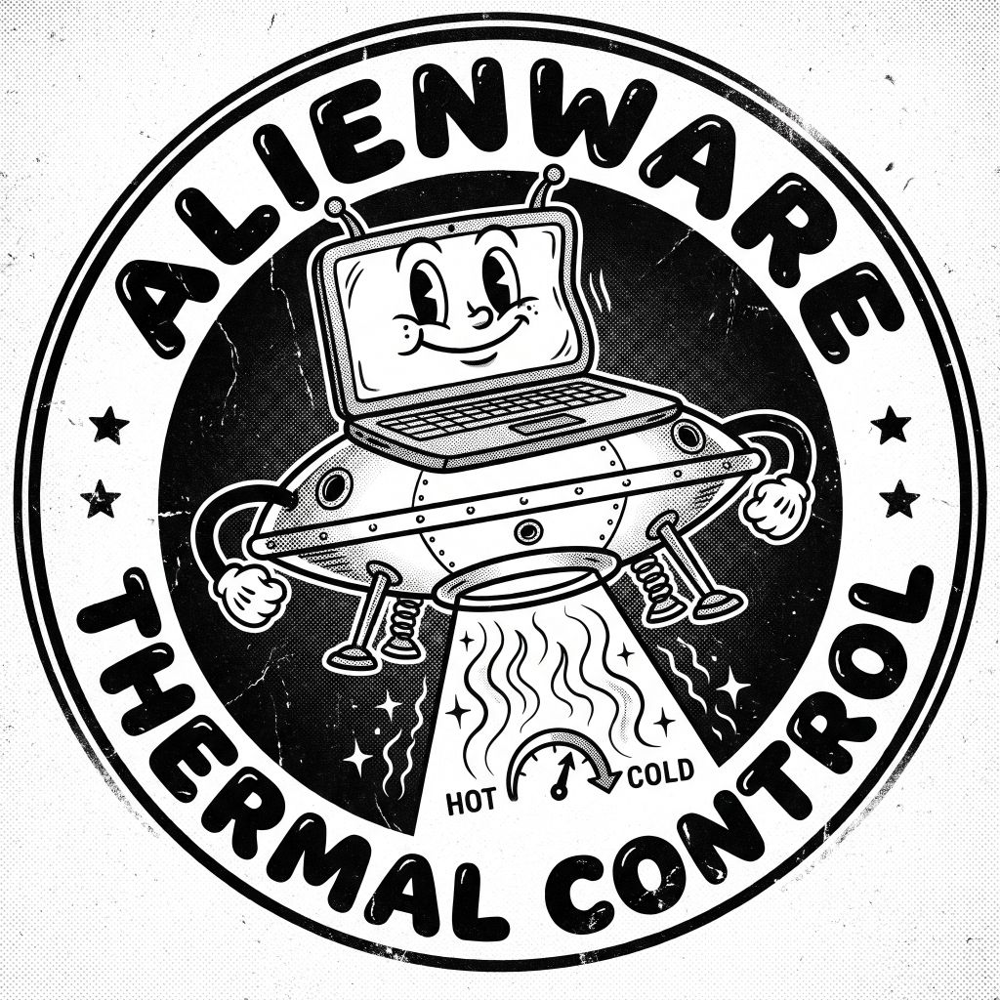

# MyAlien

<p align="center"></p>

Lightweight thermal and battery care for the **Dell G15 5520**: a small alternative to MyDell /
Alienware Command Center, limited to thermal profiles, fans and battery charging.

It talks to the firmware only through interfaces Windows already exposes (the inbox ACPI-WMI driver,
the battery class driver, power APIs). No Dell DLLs, no direct hardware access. It works with or
without MyDell installed.

Status (verified on a G15 5520):
* **Command line** (`myalien.exe`): every command below.
* **Windows service**: every command works without elevation, the last setting is kept across
  sleep / boot, and MyDell is detected and left alone.
* **Tray icon** (`myalien-tray.exe`): profile badge, menu, and a status window for profile, G-Mode,
  fan boost, charging and game mode; light and dark theme.
* **Game mode** (opt-in): while a game is in front, switch the thermal profile and the Windows power
  mode, then restore them ([docs/game-mode.md](docs/game-mode.md)).
* **Installer** (`myalien-setup.exe`): install, update and uninstall (see below).

## Install

Download `myalien-setup.exe` from the [releases](https://github.com/thebrave/myalien/releases) and run
it (it asks for administrator rights). It installs to `C:\Program Files\MyAlien`: the service, the
tray icon (started at sign-in for every user, and right away for you), the `myalien` command line, a
Start menu shortcut and an entry in **Settings → Apps**. Running a newer setup updates in place.

To uninstall, use **Settings → Apps → MyAlien → Uninstall** (or run setup again). Logs and settings
are kept unless you tick *Also remove logs and settings*; the thermal profile and charging mode stay
as they are. Setup also takes `/quiet`, `/nostart`, `/uninstall` and `/purge`.

The setup is not code-signed: Windows SmartScreen shows a warning the first time.

## What it can do

| Command | |
|---|---|
| `myalien status` | Profile, G-Mode, temperatures, fans, battery health, charge mode |
| `myalien profile set <balanced\|balanced-performance\|quiet\|low-power\|custom>` | Thermal profile |
| `myalien gmode on` / `gmode off [<profile>]` | G-Mode (maximum cooling) |
| `myalien fan boost <cpu\|gpu\|all> <0-100>` | Manual fan boost, in the Custom profile |
| `myalien battery mode <adaptive\|standard\|express\|primacuse>` | BIOS charge mode |
| `myalien battery mode custom <start> <stop>` | Charge only between two levels, e.g. `50 80` |
| `myalien powermode [set <efficiency\|balanced\|performance>]` | Windows power mode (no service needed) |
| `myalien games [watch]` | Games found in launcher catalogs, and live foreground detection |

Changes go through the MyAlien service (or need an **elevated prompt** without it) and are only
enabled on a Dell G15 5520. Each one is read back from the firmware before the command reports `OK`. Full reference: [docs/cli.md](docs/cli.md).

## Build

Requires Visual Studio 2022 (Desktop development with C++); CMake ships with it.

```
cmake --preset vs2022
cmake --build --preset release
ctest --test-dir build/vs2022 -C MinSizeRel
```

The `release` preset builds `MinSizeRel` into `build/vs2022/src/<cli|svc|tray|setup>/MinSizeRel/`:
`myalien.exe`, `myalien-svc.exe`, `myalien-tray.exe` (single self-contained files, static CRT) and
`myalien-setup.exe`, which carries the other three. Run the setup to install a build; or, for
development, install only the service with `myalien-svc --install` from an elevated prompt and start
`myalien-tray.exe` from the build folder (see [docs/cli.md](docs/cli.md)).
If `cmake` is not on `PATH`, use a "Developer PowerShell for VS 2022" or VS's bundled
`Common7\IDE\CommonExtensions\Microsoft\CMake\CMake\bin\cmake.exe`.

## Documentation

| Document | Content |
|---|---|
| [docs/cli.md](docs/cli.md) | Command reference, examples, exit codes |
| [docs/architecture.md](docs/architecture.md) | Code layout, core library, safety model |
| [docs/firmware.md](docs/firmware.md) | Dell WMI interfaces used and what was verified on the G15 5520 |
| [docs/game-mode.md](docs/game-mode.md) | Game detection research and game mode design |
| [PLAN.md](PLAN.md) | Project plan, phases, discovery notes, open questions |

## Layout

| Path | Content |
|---|---|
| `src/core` | `myalien-core` static library: WMI wrapper, Dell AWCC thermal interface, Dell BIOS attributes, charge planner, battery, system queries |
| `src/cli` | `myalien.exe` command line |
| `src/svc` | `myalien-svc.exe` Windows service (pipe server, thermal monitor) |
| `src/tray` | `myalien-tray.exe` tray icon, menu, status and Games windows, game mode, light / dark theme |
| `src/setup` | `myalien-setup.exe` installer (carries the three programs as resources) |
| `tests` | Unit tests (charge planner, snapshot wire format, actions, thermal state, game catalog, game mode) |
| `tools/discovery` | Phase 0 read-only discovery script |
| `res` | Application icon and version resources |
| `docs` | Documentation and logo; `docs/discovery` holds local discovery dumps (git-ignored) |

## License

MIT — see [LICENSE](LICENSE). Linux drivers and other GPL projects were used as interface
documentation only; no code was copied from them.
